<picture>
  <source media="(prefers-color-scheme: dark)" srcset="assets/hero-dark.svg" />
  <source media="(prefers-color-scheme: light)" srcset="assets/hero-light.svg" />
  
</picture>

<a href="https://eljcf.github.io/">
  <picture>
    <source media="(prefers-color-scheme: dark)" srcset="assets/resume-dark.svg" />
    <source media="(prefers-color-scheme: light)" srcset="assets/resume-light.svg" />
    
  </picture>
</a>

## SELECTED WORK

**01 / [Gemini-exporter](https://github.com/eljcf/Gemini-exporter)**  
完整导出 Gemini 超长对话，并在新对话中恢复上下文。  
`JavaScript` · `Chrome Extension MV3` · `DOM API`

## TECH STACK

**Product**　AI Product · RAG · Agent Systems  
**Build**　JavaScript · Chrome Extension · DOM API

## CONTRIBUTION

<picture>
  <source media="(prefers-color-scheme: dark)" srcset="https://raw.githubusercontent.com/eljcf/eljcf/output/github-snake-dark.svg" />
  
</picture>
