<picture>
  <source media="(prefers-color-scheme: dark)" srcset="assets/profile-dark.svg" />
  <source media="(prefers-color-scheme: light)" srcset="assets/profile-light.svg" />
  
</picture>

## 🔭 Focus

- **AI 产品与 Agent**：从真实场景出发设计 AI 能力，关注模型之外的交互体验、任务边界与可落地性。
- **RAG / 数据处理**：关注检索质量、上下文组织与可溯源，把 messy data 变成真正可用的信息。
- **Developer Tools**：做小而实用的工具，用可运行的产品解决具体问题。

## 🧩 Featured Projects

| 项目 | 说明 | 技术 |
| --- | --- | --- |
| [Gemini-exporter](https://github.com/eljcf/Gemini-exporter) | 一键完整导出 Gemini 超长对话为 Markdown / JSON，并通过启动 Prompt 在新对话中恢复上下文 | JavaScript · Chrome Extension MV3 · DOM API |

**从网页限制到完整导出**：自动回溯加载历史消息，用「角色 + 文本指纹」去重并清洗系统干扰词；所有处理均在浏览器本地完成，零数据上传，仅申请 `activeTab` 权限。已在 [Chrome 应用商店](https://chromewebstore.google.com/detail/gemini-exporter/djeafpklmikmngppfngljfbnnndcbeai) 上架。

## 🧭 How I Work

| 01 / FRAME | 02 / BUILD | 03 / EVALUATE |
| --- | --- | --- |
| 先定义真实问题与使用场景，再选择模型和工具。 | 用可运行原型验证交互、数据链路与异常边界。 | 关注检索质量、上下文组织、可溯源与最终体验。 |

## 🛠 Tech Stack

  

**Product**：AI 产品设计 · RAG · Agent　**Build**：JavaScript · Chrome Extension · DOM API

## 🐍 Contributions

<picture>
  <source media="(prefers-color-scheme: dark)" srcset="https://raw.githubusercontent.com/eljcf/eljcf/output/github-snake-dark.svg" />
  
</picture>
