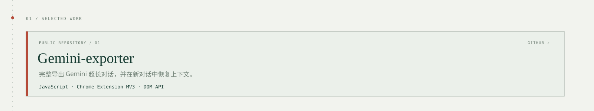

<picture>
  <source media="(prefers-color-scheme: dark)" srcset="assets/hero-dark.svg" />
  <source media="(prefers-color-scheme: light)" srcset="assets/hero-light.svg" />
  
</picture>
<a href="https://eljcf.github.io/">
  <picture>
    <source media="(prefers-color-scheme: dark)" srcset="assets/resume-dark.svg" />
    <source media="(prefers-color-scheme: light)" srcset="assets/resume-light.svg" />
    
  </picture>
</a>
<a href="https://github.com/eljcf/Gemini-exporter">
  <picture>
    <source media="(prefers-color-scheme: dark)" srcset="assets/work-dark.svg" />
    <source media="(prefers-color-scheme: light)" srcset="assets/work-light.svg" />
    
  </picture>
</a>
<picture>
  <source media="(prefers-color-scheme: dark)" srcset="assets/tech-dark.svg" />
  <source media="(prefers-color-scheme: light)" srcset="assets/tech-light.svg" />
  
</picture>
<picture>
  <source media="(prefers-color-scheme: dark)" srcset="https://raw.githubusercontent.com/eljcf/eljcf/output/github-snake-dark.svg" />
  <source media="(prefers-color-scheme: light)" srcset="https://raw.githubusercontent.com/eljcf/eljcf/output/github-snake.svg" />
  
</picture>

